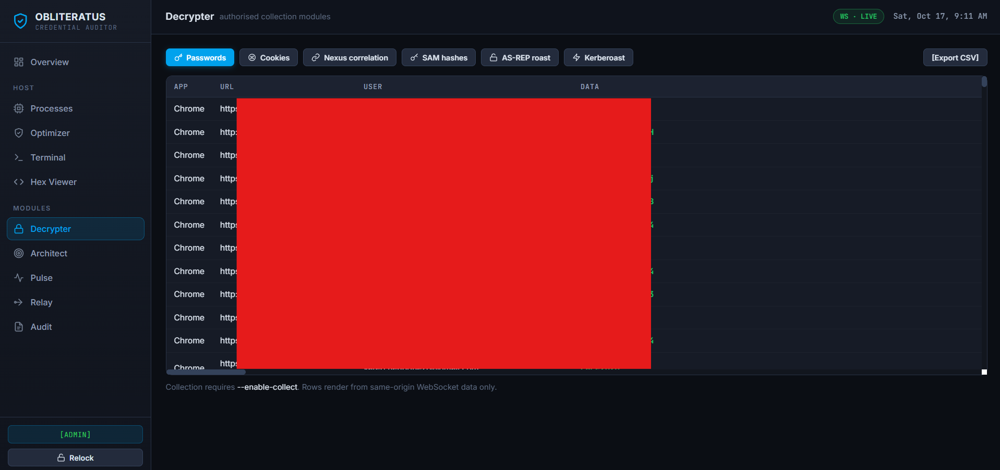
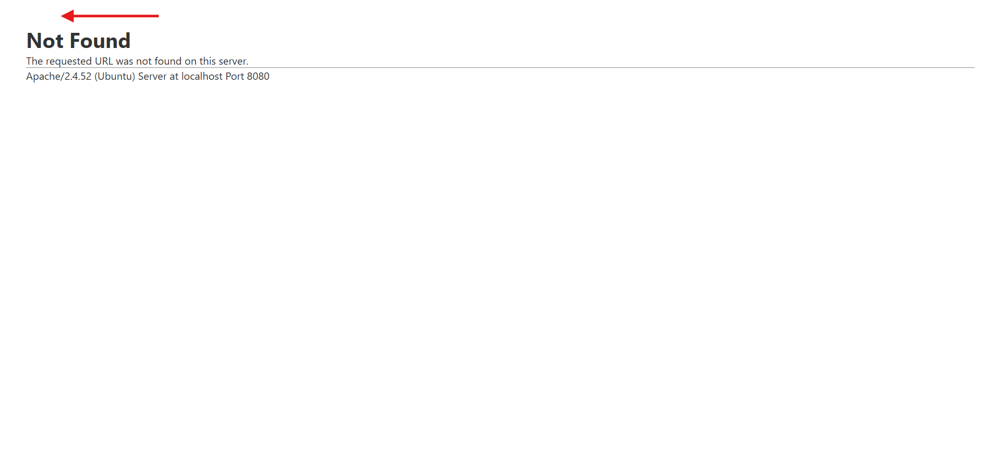

# OBLITERATUS — Windows Credential Exposure Auditor

### The Mimikatz playbook, run as a defensive checklist

<p align="center">
  
</p>

[](https://github.com/DevCop95/pullgoscript/actions/workflows/ci.yml)


**[Project site](https://devcop95.github.io/pullgoscript/)** — the same information, laid out as a browsable reference: every route with the flag that unlocks it, the twelve audit controls, how to verify a release, and the security model with its two documented limits. The download table reads the newest release from the GitHub API, so it does not go stale between releases.

**OBLITERATUS** answers one question — *would Mimikatz work against this host?* — and answers it with evidence: registry state, token privileges, service configuration and browser store exposure, each mapped to the exact Mimikatz module and MITRE technique it corresponds to.

It ships as a single binary with two modes:

| Mode | Command | Audience |
|---|---|---|
| **Headless audit** | `obliteratus.exe --audit` | CI, scripted hardening reviews, blue-team baselines |
| **Local dashboard** | `obliteratus.exe` | Operators who want the interactive console on `127.0.0.1` |

Every offensive capability is **compiled in but locked**. A locked route answers `403` with the flag that would unlock it, until the operator passes that flag explicitly:

| Flag | Unlocks | Techniques |
|---|---|---|
| *(none)* | Audit, process table, terminal, telemetry hardening | — |
| `--enable-collect` | Browser credential & cookie stores, Identity Nexus, LSASS minidump, SAM hashes, Kerberos roasting, SPN enumeration | T1003.001 · T1003.002 · T1555.003 · T1558.003 · T1558.004 |
| `--enable-persist` | Persistence foothold manager: Run keys, Startup folder, scheduled tasks, WMI subscriptions | T1547.001 · T1547.009 · T1053.005 · T1546.003 |
| `--enable-evasion` | Self-telemetry evasion: `ntdll!EtwEventWrite` and `amsi!AmsiScanBuffer` patches, in-process only | T1562.006 · T1562.001 |
| `--enable-lateral` | Remote execution over WinRM (WS-Management) and SCM (service create/start/delete) | T1021.006 · T1021.002 / T1569.002 |
| `--enable-inject` | Halo's Gate indirect-syscall process injection (amd64) | T1055 |

Unlocking a module prints a `[!] ... UNLOCKED (authorised engagements only)` banner at startup — the effect is never silent. Hiding blindly is how operators get surprised.

---

## ⚡ Quick start

```powershell
# build
go build -o bin\obliteratus.exe .\cmd\obliteratus

# headless attack-surface audit (exit code 1 = CRITICAL/HIGH control failing)
bin\obliteratus.exe --audit

# machine-readable variants
bin\obliteratus.exe --audit --json > report.json
bin\obliteratus.exe --audit --csv  > report.csv

# interactive dashboard (loopback only, ephemeral 256-bit token)
bin\obliteratus.exe
# → http://127.0.0.1:8080/   [add --elevate for privileged checks]

# full operator console: every module unlocked
bin\obliteratus.exe --enable-collect --enable-persist --enable-evasion --enable-lateral --enable-inject
# --enable-collect auto-elevates via UAC: the SAM hives, LSASS and the
# browser App-Bound key unwrap cannot work with a filtered token.
```

Or use the Makefile: `make build`, `make audit`, `make test`, `make cross`.

Prebuilt binaries are attached to each [tagged release][releases] (checksums +
SPDX SBOM, keyless-signed with cosign). How to verify them — and why the `.exe`
is **not** Authenticode-signed — is in **[docs/SIGNING.md](docs/SIGNING.md)**.

[releases]: https://github.com/DevCop95/pullgoscript/releases

### Full flag reference

| Flag | Default | Meaning |
|---|---|---|
| `--addr` | `127.0.0.1:8080` | Listen address. **Must be loopback** — the server refuses anything else |
| `--audit` | `false` | Run the audit headlessly and exit |
| `--json` / `--csv` | `false` | Emit the audit report in machine-readable form |
| `--elevate` | `false` | Force a UAC relaunch up front. Also implied by `--enable-collect`, which cannot work unelevated |
| `--payload` | `payloads/research_signal.bin` | Payload file for the injection module |
| `--payload-key` | `""` | Passphrase to unpack an encrypted payload (see `cmd/oblpack`) |
| `--enable-collect` | `false` | UNLOCK credential/cookie collection (**auto-elevates via UAC**) |
| `--enable-persist` | `false` | UNLOCK the persistence manager |
| `--enable-evasion` | `false` | UNLOCK self-telemetry evasion |
| `--enable-lateral` | `false` | UNLOCK lateral movement (WinRM + SCM) |
| `--enable-inject` | `false` | UNLOCK the process-injection research module |
| `--version` | — | Print version and exit |

---

## 🔬 The audit checklist

Every finding carries a stable ID, severity, evidence, remediation, the MITRE technique and the Mimikatz module it maps to.

| ID | Control | Mimikatz module | MITRE | Severity |
|---|---|---|---|---|
| `MK-WDIGEST` | WDigest does not cache plaintext credentials | `sekurlsa::wdigest` | T1003.001 | CRITICAL |
| `MK-AUTOLOGON-PASS` | No cleartext password in Winlogon | `winlogon\DefaultPassword` | T1552.001 | CRITICAL |
| `MK-LSASS-PPL` | LSASS runs as a protected process | `sekurlsa::logonpasswords` | T1003.001 | HIGH |
| `MK-CREDGUARD` | Credential Guard / VBS enabled | `sekurlsa::logonpasswords` | T1003.001 | HIGH |
| `MK-SEDEBUG` | SeDebugPrivilege not enabled in token | `privilege::debug` | T1134.001 | HIGH |
| `MK-AV` | Endpoint protection installed and enabled | — | T1562.001 | HIGH |
| `MK-PSLOG` | PowerShell Script Block Logging enabled | — | T1059.001 | MEDIUM |
| `MK-LAPS` | Managed local admin password in use | — | T1078.002 | MEDIUM |
| `MK-AUTOLOGON` | Automatic logon disabled | `lsadump::secrets` | T1003.004 | MEDIUM |
| `MK-SYSMON` | Sysmon / EDR telemetry installed | — | — | LOW |
| `MK-CACHEDLOGONS` | Cached domain logon count reviewed | `lsadump::cache` | T1003.005 | INFO |
| `MK-CONTEXT` | Audit execution context (elevated or not) | — | — | INFO |

Checks degrade to `unknown` (never to a false `pass`) when a privilege or asset is missing — an honest audit reports what it could *not* see. Adding a check is one function plus one line in `RunChecks`; see [CONTRIBUTING.md](CONTRIBUTING.md).

---

## 🖥️ Dashboard

Local-only web console on `127.0.0.1` — sidebar layout with modal confirmations, toasts and CSV export. Ten views:

| View | What it does | Gate |
|---|---|---|
| **Overview** | Host snapshot, module status, quick actions | — |
| **Processes** | Live process table with filter and PID targeting | — |
| **System Optimizer** | One-click telemetry/privacy hardening (registry + `DiagTrack`) | — |
| **Terminal** | Command console with streamed output | — |
| **Hex Viewer** | Payload integrity inspection | — |
| **Decrypter** | Browser credential & cookie collection, Identity Nexus, SAM dump, Kerberos roasting | `--enable-collect` |
| **Architect** | Indirect-syscall injection research | `--enable-inject` |
| **Pulse** | Persistence foothold manager (Run / Startup / Task / WMI) | `--enable-persist` |
| **Relay** | Remote execution over WinRM and SCM | `--enable-lateral` |
| **Attack-Surface Audit** | The Mimikatz checklist, interactive, CSV export | — |

<p align="center">
  
  <br><i>The console hides behind a simulated Apache 404 until the handshake (F2, three clicks on "Not Found", or the top-left hotspot) — cosmetic only; the real boundary is the per-run token.</i>
</p>

---

## 🔒 Security model

OBLITERATUS v1 had critical local exposure holes; v2 closes them and the test-suite pins the behaviour closed:

| # | v1 problem | v2 control |
|---|---|---|
| 🔴 | Listened on **`:8080` (all interfaces)** — LAN-reachable console | Binds `127.0.0.1` only; `ListenAndServe` **refuses** non-loopback addresses |
| 🔴 | Token derived from the **PID** (visible to any process) and echoed to unauthenticated `GET /` | 256-bit `crypto/rand` token, regenerated per run, constant-time compare |
| 🔴 | `CheckOrigin: return true` — **any web page could open the WebSocket** and drive the console | Origin must be loopback **and** `?t=` token must match |
| 🔴 | No Host validation — **DNS rebinding** could read the token from the page | Every route rejects non-loopback `Host` headers |
| 🟠 | Mixed GET mutations, no method enforcement | `ServeMux` method patterns → automatic `405` on wrong verbs |
| 🟠 | Token in HTML readable cross-origin (no CSP/headers) | Same-origin only + CSP, `nosniff`, `DENY` framing, `no-store` |
| 🟠 | DOM XSS: DB-derived URLs rendered via `innerHTML` | All server data escaped through `window.esc()` before `innerHTML` |
| 🟡 | Auto-UAC on every start | Elevation only when asked for: `--elevate`, or a module that cannot work unelevated (`--enable-collect`) |
| 🟡 | Credentialed collectors reachable by default | Locked behind `--enable-*` flags, fail closed with an actionable `403` |
| 🟡 | Privileged modules failed **opaquely** — SAM errors rendered as "no SAM material", LSASS failures hung the UI | Real cause streamed to the dashboard (`sam_error` / `lsass_error`); UAC is requested up front, and a relaunch that yields no elevated token fails loudly instead of looping |

**Trust boundary:** anyone who can read the dashboard page (loopback, same-origin) is the operator. Cross-site pages can *reach* the port but cannot read responses, cannot set the custom header without a preflight we never approve, and cannot complete the WebSocket handshake. See [docs/ARCHITECTURE.md](docs/ARCHITECTURE.md) for the full threat model and [SECURITY.md](SECURITY.md) for the reporting process.

### Intentional capabilities (features, not bugs)

`POST /v1/sys/cmd` executes shell commands as the token holder; `--enable-collect` decrypts browser stores and the local SAM **on the local host**; `--enable-inject` performs W^X injection into an operator-selected local PID. They are reachable only over loopback, only with the per-run token, and only with the matching flag. Hardening regressions in that chain *are* in scope.

---

## 🗂️ Architecture

```
cmd/obliteratus/        CLI: flags, --audit mode, wiring
cmd/oblpack/            Payload packer (AES-256-GCM container, magic OBLP\x01)
internal/
  audit/                ★ Mimikatz attack-surface checks + report (JSON/CSV)
    host_windows.go       12 controls: WDigest, PPL, CredGuard, SeDebug…
    collector_windows.go  authorised browser collectors (--enable-collect)
    lsass_windows.go      sekurlsa::logonpasswords — LSASS minidump (--enable-collect)
    sam_windows.go        lsadump::sam: RegSaveKeyEx + [MS-SAMR] hash chain
    regf.go               offline registry-hive parser (regf reader)
  krb/                  Kerberos roasting: AS-REP (T1558.004) + Kerberoast (T1558.003)
  lateral/              Lateral movement (--enable-lateral)
    winrm.go              WS-Management SOAP client, Basic auth (T1021.006)
    scm_windows.go        SCM service create/start/delete (T1021.002 / T1569.002)
  persist/              Persistence manager (--enable-persist)
    persist_windows.go    Run keys (T1547.001), Startup (T1547.009),
                          schtasks (T1053.005), WMI subscription (T1546.003)
  research/             Self-evasion + injection (amd64)
    dll_windows.go        shared W^X prologue patcher (idempotent)
    etw_windows.go        ntdll!EtwEventWrite neuter (T1562.006)
    amsi_windows.go       amsi!AmsiScanBuffer patch (T1562.001)
    pack.go               AES-256-GCM payload container (OBLP\x01)
    inject_windows.go     Halo's Gate indirect-syscall injection (--enable-inject)
    energyflow_amd64.s    the syscall trampoline
  obfuscate/            Compile-time masking for sensitive string literals
  winname/              Masked Windows API names (kept out of the symbol table)
  server/               Loopback HTTP API, auth middleware, WS hub, handlers
  token/                Per-run 256-bit token (crypto/rand, constant-time cmp)
  ui/                   Embedded dashboard (//go:embed)
  elevate/              UAC relaunch (--elevate, or forced by --enable-collect)
  winutil/              Process table, telemetry hardening
docs/                   HALOS_GATE research note, architecture, images
build/                  Manifest for optional requireAdministrator builds
```

Dependency direction: `cmd → server → {audit, research, ui, …}`. The `audit` package never imports `server` — progress is reported through an `Emitter` callback — so checks stay unit-testable.

- **Research notes:** [docs/HALOS_GATE.md](docs/HALOS_GATE.md) — SSN recovery, indirect syscalls, W^X page transitions (`NtAllocateVirtualMemory` RW → `NtProtectVirtualMemory` RX: no RWX page ever exists).
- **Build details:** [docs/ARCHITECTURE.md](docs/ARCHITECTURE.md).

---

## 🧪 Testing

```bash
make test    # gofmt check + go vet + go test ./...
make build   # windows/amd64 binary
make cross   # cross-compile check (what CI runs on Linux)
make audit   # run the audit against this machine
```

CI runs `gofmt`, `go vet`, `go test` and an audit smoke test on a real Windows runner, then cross-compiles from Linux and runs the platform-neutral package tests — so the `//go:build` stubs are exercised on every push and PR.

---

## 🤝 Contributing

New audit checks, fixes and docs are welcome — see [CONTRIBUTING.md](CONTRIBUTING.md). Found a vulnerability in the dashboard/API? See [SECURITY.md](SECURITY.md).

## 📄 License

[MIT](LICENSE) © DevCop95 (Yared Henriquez).

## ⚠️ Disclaimer

OBLITERATUS is for **authorized security assessment, research and education** on systems you own or are contracted to test. The credential-collection, persistence, evasion, lateral-movement and injection modules are deliberately locked; unlocking them is an explicit acknowledgement that your engagement permits their use. Unauthorized access to computer systems is illegal.

---
*Assume breach. Audit the credentials before someone else does.*
